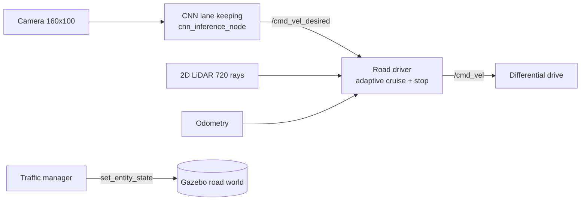

# Autonomous Driving for a Small-Scale Vehicle

**CNN lane keeping, LiDAR adaptive cruise control and obstacle avoidance in ROS 2 and Gazebo**

A small differential-drive robot acts as an autonomous car on a 1:10-scale road. A convolutional neural network (CNN) keeps it in its lane from the camera image. A 2D LiDAR controls its speed around other traffic and lets it steer around obstacles and back into its lane. Everything runs in ROS 2 Humble with Gazebo 11.

> **Status (October 2026):** lane following, adaptive cruise control (following a slower car), stopping for a crossing car and ignoring oncoming traffic are all validated in Gazebo. Obstacle avoidance with DWA was validated in an earlier test world.

---

## System overview



The work is split the way most autonomous-driving stacks are:

| Layer | Node | What it does |
|---|---|---|
| Lateral control | `cnn_inference_node.py` | Predicts a steering rate from the camera image to stay between the lane lines |
| Longitudinal control | `road_driver.py` | Watches a corridor straight ahead in its own lane. Cruises when clear, follows a slower car at a constant time gap (gap = 0.5 m + 1.0 s × speed), and stops for anything crossing in front. Oncoming traffic in the other lane is ignored |
| Obstacle avoidance | `dwa_obstacle_avoidance.py` | Dynamic Window Approach: samples 217 speed/turn-rate arcs, rejects any that would hit an obstacle, and picks the best one. Uses odometry to return to the lane line after a swerve |
| Traffic | `traffic_manager.py` | Moves the other cars: oncoming, a slower car ahead, and a car crossing at a junction |

## Results so far

| Test | Environment | Result |
|---|---|---|
| Lane following | Gazebo | 18.75 m driven, ending 1.8 cm from the lane centre |
| CNN retraining | Offline | 2,000 synthetic images, 40 epochs, final MSE loss 0.0003 |
| Obstacle avoidance (5 layouts) | Offline closed-loop test | All passed; minimum clearance 0.46 to 0.58 m; about 7 ms planning time per cycle |
| Obstacle avoidance | Gazebo (earlier test world) | Passed a 1.5 m obstacle at 0.5 m/s with at least 0.52 m clearance, returned to the lane about 26 s after detection |
| Slower car ahead | Gazebo | Followed at a 0.74 to 0.83 m gap (target 0.75 m), matching the lead car's 0.25 m/s; returned to 0.5 m/s cruise when it left |
| Crossing car | Gazebo | Stopped 0.54 to 0.55 m from the crossing car, waited, then accelerated back to 0.5 m/s once it had passed |
| Oncoming cars | Gazebo | Held 0.5 m/s for the whole run and never reacted to traffic in the other lane |
| Sensor-noise robustness | Offline, 1 cm LiDAR noise | State switching while following cut from 30 to 9 per run, and while waiting at a crossing from 40 to 6, after adding hysteresis and a stop hold |

## Repository layout

## Running it

Requirements: Ubuntu 22.04, ROS 2 Humble, Gazebo 11 with `gazebo_ros_pkgs`, PyTorch and OpenCV.

```bash
# build
mkdir -p ~/ros2_ws/src && cd ~/ros2_ws/src
git clone https://github.com/worshub05/Roboticsproject.git
cp -r Roboticsproject/src/lane_follower_perception .
cd ~/ros2_ws && colcon build --symlink-install
source install/setup.bash

# train the CNN (writes ~/ros2_ws/models/lane_cnn_v2.pt)
python3 Roboticsproject/generate_training_data.py
python3 Roboticsproject/retrain_cnn.py

# road demo with all traffic
ros2 launch lane_follower_perception road_phase1.launch.py
# or one situation at a time
ros2 launch lane_follower_perception road_phase1.launch.py scenario:=follow   # oncoming | follow | crossing
```

Useful topics while it runs: `/road/state` (CRUISE, FOLLOW or STOP), `/road/gap`, `/road/lead_speed`, `/cmd_vel`.

The trained model file (`lane_cnn_v2.pt`, about 17 MB) is not stored in the repository; it is produced by `retrain_cnn.py`.

## Roadmap

- Curved roads and a dashed centre line; retrain the CNN on images collected in Gazebo
- Overtaking a slow or parked car after checking for oncoming traffic
- Junction rules: traffic light or stop sign detected by the camera
- LiDAR object tracking with speed estimates, so crossing cars are predicted before they reach the lane
- Safety layer: emergency braking by time-to-collision, sensor-failure handling
- Scenario test suite and repeated-run evaluation
- Design study: how the ROS 2 stack would map onto a real electric vehicle (drive-by-wire, CAN bus, onboard computer)

## Limitations

- The CNN is trained on synthetic images of straight lane lines, so curved roads and real camera images need further training.
- The speed controller's corridor assumes a straight lane.
- This is a 1:10-scale simulation for research and teaching. It is not a road-legal or safety-certified driving system.

## License

See [LICENSE](LICENSE).
