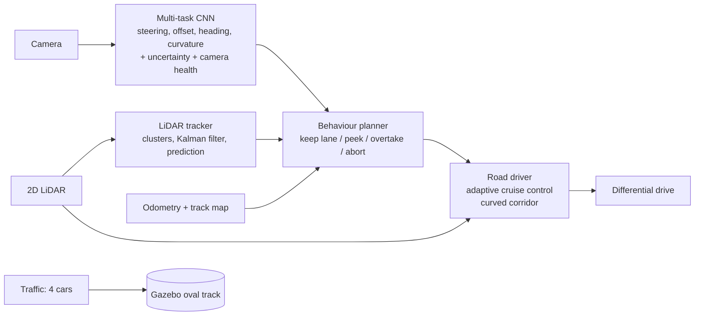

# Self-Monitoring Autonomous Driving for a 1:10-Scale Vehicle

[](https://github.com/worshub05/Roboticsproject/actions/workflows/tests.yml)

**ROS 2 Humble · Gazebo 11 · PyTorch** · project by Shubham

A small differential-drive robot drives as an autonomous car on a two-lane oval road with traffic. It keeps its lane with a multi-task CNN, controls its speed around other cars with a LiDAR, tracks and predicts the surrounding cars, and overtakes slow or parked cars on a two-way road when it is safe. It also watches its own reliability: it detects camera faults and notices when the neural network is unsure, and slows down or stops.

> **Status (31 October 2026):** perception, self-monitoring, curved adaptive cruise control, LiDAR tracking and prediction, and overtaking are all validated in Gazebo. Next: MPC, a formal safety layer (RSS and time-to-collision braking), V2I and platooning, and a scenario test suite.

---

## System overview



| Layer | Node / module | What it does |
|---|---|---|
| Lane keeping | `multitask_inference_node.py`, `multitask_cnn.py` | One CNN predicts steering plus lane offset, heading error and road curvature ahead. Monte Carlo dropout gives its uncertainty; the car slows down when it is unsure |
| Self-monitoring | `multitask_inference_node.py` | Camera health checks independent of the network: too dark, too bright, no contrast, too noisy (Immerkaer noise estimate), frozen, or no new images. Any fault stops the car |
| Speed control | `road_driver.py` | Adaptive cruise control with a constant time gap (gap = 0.5 m + 1.0 s x speed). The LiDAR corridor bends with the curvature from the CNN, so a car ahead on a bend stays in view |
| Object tracking | `lidar_tracker.py`, `lidar_objects.py`, `mot.py` | Clustering, L-shape box fitting with a car-size prior, one constant-velocity Kalman filter per car (position, speed, stable ID), coasting through short occlusions |
| Prediction | `predict.py`, `track_map.py` | Where each car will be in 1, 2 and 3 s, following its lane on the map; also which lane it is in and whether it is oncoming |
| Behaviour | `overtake_planner.py` | Two-way road overtaking: peek past the slow car, occlusion-aware check of the oncoming lane, measured oncoming speeds, lane change, pass, return, abort |
| Traffic and ground truth | `track_traffic.py` | Slow car, parked car and two oncoming cars; publishes true positions and velocities for evaluation |

## Results (Gazebo)

| Test | Result |
|---|---|
| Lane keeping on the curved track (CNN v3) | about 1.1 cm mean offset, 100% of the time in lane, both directions |
| Multi-task CNN (validation) | steering error 0.022 rad/s, lane offset 1.3 cm, heading 0.024 rad, curvature 0.013 1/m |
| Uncertainty | the 10% most uncertain images have twice the steering error (correlation +0.31) |
| Camera faults: black, dark, noise, frozen | all detected within 1 to 3 s, car stopped. Noise was first missed (the car left the road with no alarm), then fixed with the noise check |
| Lead car on a bend | first seen at **3.99 m** with the curved corridor vs **1.87 m** straight (7.9 s vs 0.9 s of warning) |
| Overtaking, 4 cars | 6 overtakes in a row, **0 collisions**, including two cars back to back |
| Object detection | 0.9 cm median centre error, 3 false detections in 9,540 scans |
| Tracking | 99.5% of visible cars tracked, 9.4 cm 95% position error, **1.0 cm/s** median speed error, **0 ID switches**, 64% of hidden cars kept by coasting |
| Prediction, bends, 3 s ahead | median error **1.6 cm** (lane following) vs 10.1 cm (constant velocity) |
| Planner with measured speeds (oncoming 0.15 m/s) | waited **6.2 s** behind a slow car instead of 51.2 s, no collisions |

## Repository layout

```
src/lane_follower_perception/
├── lane_follower_perception/
│   ├── multitask_cnn.py            # multi-task CNN + Monte Carlo dropout
│   ├── multitask_inference_node.py # lane keeping, uncertainty, camera health, fault injection
│   ├── lane_cnn_model.py           # steering CNN backbone
│   ├── road_driver.py              # adaptive cruise control with curved corridor
│   ├── overtake_planner.py         # behaviour planner (overtaking on a two-way road)
│   ├── lidar_objects.py            # LiDAR clustering + box fitting
│   ├── mot.py                      # Kalman multi-object tracker
│   ├── predict.py, track_map.py    # motion prediction and the track map
│   ├── lidar_tracker.py            # tracker node: /objects, /tracks, /predictions
│   ├── track_traffic.py            # traffic and ground truth on the oval track
│   ├── collect_track_data.py       # expert data collection for CNN training
│   └── traffic_manager.py, dwa_obstacle_avoidance.py, ...  # earlier straight-road work
├── launch/        track_phase2.launch.py (oval track), road_phase1.launch.py (straight road)
├── worlds/        track_oval.world, road_with_traffic.world
└── tools/         run_stack.sh, make_track.py, eval_lane.py, eval_objects.py,
                   eval_tracks.py, eval_prediction.py
train_track_cnn.py, train_multitask_cnn.py   # CNN training
```

## Running it

Requirements: Ubuntu 22.04, ROS 2 Humble, Gazebo 11 with `gazebo_ros_pkgs`, PyTorch, OpenCV, NumPy.

```bash
cd ~/ros2_ws && colcon build --symlink-install && source install/setup.bash

# terminal 1: the oval track world and the robot
ros2 launch lane_follower_perception track_phase2.launch.py drive:=false

# terminal 2 (once the robot is visible): the whole driving stack with 4 cars
~/ros2_ws/src/lane_follower_perception/tools/run_stack.sh overtake 0.3 true
```

Ground-truth checks (terminal 3): `python3 tools/eval_tracks.py`, `python3 tools/eval_prediction.py`, `python3 tools/eval_lane.py ours`.

The trained models (`lane_cnn_v3.pt`, `lane_mt_v1.pt`) and the 6,000 training images are not stored in the repository; they are produced by `collect_track_data.py` and the two training scripts.

## Roadmap

- MPC controller, compared with the current path tracker
- Safety layer: RSS safe-distance rules and time-to-collision emergency braking
- V2I traffic light and a 3-car CACC platoon (V2V)
- Scenario test suite, automatic failure search (falsification) and GitHub Actions CI
- EV energy model, a DAgger training round, and a study of how the stack maps onto a real electric vehicle

## Limitations

- Simulation only, at 1:10 scale and low speeds (0.5 to 0.7 m/s); the CNN is trained on Gazebo images.
- Localisation uses Gazebo odometry and a known track map (a stand-in for HD maps and localisation on a real car).
- The 10 m LiDAR range limits overtaking: cars faster than about 0.15 m/s cannot be overtaken unless an oncoming car is tracked in view.
- This is a research and teaching project. It is not a road-legal or safety-certified driving system.

## License

See [LICENSE](LICENSE).
